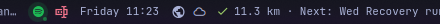
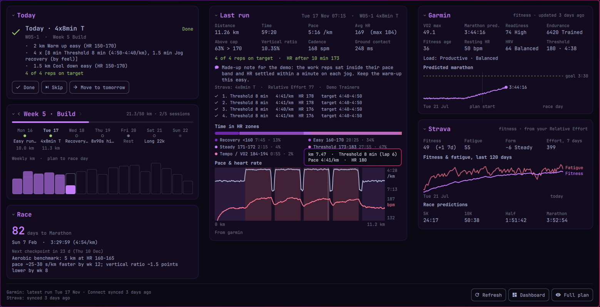
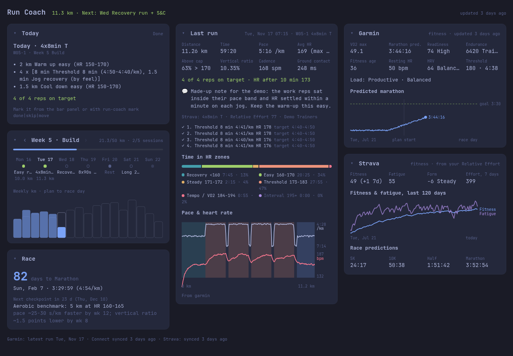

# Run Coach for Omarchy

Your running plan in the [Omarchy](https://omarchy.org) bar. It shows today's
session beside the clock, picks up every run from your Garmin watch, judges it
against what the plan asked for, and keeps your fitness and race countdown in
one panel.

Not on Omarchy? The engine is plain Python: use the **web dashboard** (any
desktop, or your phone), a **Waybar** module (Hyprland, Sway, Niri…), or both.
See [Without Omarchy](#without-omarchy).





*Screenshots use made-up demo data (`tools/make_demo.py`).*

## What it shows

**In the bar:** today's session, or the next one, with a ✓ / ⚠ / ✗ once a run
is judged. Left click opens the panel, right click refreshes, middle click
opens your full plan page if you have one.

**In the panel**, three columns that each fold (click a title; it remembers):

- **Plan:** today's session and its steps (Done / Skip / Move to tomorrow), the
  week with a dot per day (hover for the result, click for the details), a
  weekly-km chart for the whole plan (planned vs run), and the race countdown
  with your next checkpoint. Arrows beside the week browse past weeks.
- **Run:** the last run, or the day you clicked: distance, pace, HR, running
  dynamics, a verdict against the plan (*4 of 4 reps on target*, *Easy too
  hard*…), time in each HR zone, and a pace + heart-rate chart along the
  distance with the workout's stages shaded (warm-up, work, recovery,
  cool-down). Hover the chart for km, stage, pace and HR. Optional coach note.
- **Dashboard** button: the same view as a web page (below).
- **Fitness:** Garmin's VO2 max, predicted marathon (with a trend chart against
  your goal), readiness, endurance score, HRV, resting HR, threshold and
  training-load balance. From Strava: Fitness / Fatigue / Form and race
  predictions from your best efforts.

## Requirements

- Omarchy with its shell (bar plugins), or see [Without Omarchy](#without-omarchy).
- A Garmin watch is the main data source. Any watch that exports `.fit` files
  (Coros, Suunto, Polar, Wahoo…) works through the folder option, and Strava
  works for everyone, alone or combined.
- `uv` (preinstalled on Omarchy) or `python3 -m venv`.
- Optional: [Claude Code](https://claude.com/claude-code) for the coach notes.

## Install

```bash
omarchy plugin add https://github.com/okox/omarchy-run-coach.git
~/.config/omarchy/plugins/okox.run-coach/setup.sh
```

Or clone it anywhere and run `./setup.sh`. Setup installs a small Python
engine (in its own venv), a `run-coach` command, a systemd user timer that
refreshes every 15 minutes, and puts the widget beside the clock. Re-run it
any time; it never touches your plan, history or logins.

Update with `omarchy plugin update okox.run-coach`, then run `setup.sh` again.

## Your plan

Run Coach needs a plan in `~/.config/run-coach/plan.json`. Start from the
bundled 16-week sub-3:30 marathon example, moved to your race date:

```bash
run-coach init-plan --race-date 2027-04-18 --race-name "Spring Marathon" --short "Marathon" --target 3:29:59
```

Then **set your own heart-rate zones** in it, and check the paces suit you.
[PLAN.md](PLAN.md) explains every field, so you can also write your own plan
or have an AI turn your coach's plan into this format.

## Getting your runs in

Pick any of these; they can be combined, and a run found twice counts once.

**Garmin Connect (recommended).** Downloads the original `.fit` file of each
new run (laps, workout steps, HR, running dynamics) and Garmin's fitness
numbers. Run in a terminal:

```bash
run-coach garmin-auth
```

Only a login token is saved (`~/.config/run-coach/garmin_tokens.json`, mode
0600), never your password. This uses the unofficial
[garminconnect](https://github.com/cyberjunky/python-garminconnect) library,
so a change on Garmin's side can break it until the library is updated.

**A folder of `.fit` files.** If you copy files off the watch yourself, set the
folder in `~/.config/run-coach/config.json` and re-run `setup.sh` (it adds a
watcher that picks up new files within seconds):

```json
{ "activity_dir": "~/Fitness/Activity" }
```

**Strava.** Adds each run's name, description, Relative Effort, kudos and
shoes, plus the Strava fitness section. Strava needs your own (free) API app:

1. Go to https://www.strava.com/settings/api and create an app: any name,
   category *Training*, website `http://localhost`, **Authorization Callback
   Domain `localhost`**, and any icon (`assets/icon.png` is there for that).
2. In a terminal run `run-coach strava-auth`, paste the Client ID and Client
   Secret, and approve in the browser (tick *View data about your
   activities*).

Strava's own Fitness score, race predictions and AI activity comments are not
available to other apps. Run Coach computes Fitness / Fatigue / Form the same
way Strava describes them (42- and 7-day weighted averages of daily Relative
Effort, so the numbers are close to, not identical with, the app's) and
predicts race times from your best efforts with Riegel's formula.

## Web dashboard

The whole panel as a web page: same columns, charts, hover and folding, and it
stacks into one column on a phone. The engine rewrites it on every refresh.



```bash
run-coach dashboard --open            # open ~/.local/state/run-coach/dashboard.html
run-coach dashboard --serve --open    # live at http://localhost:8724, refreshes itself
run-coach dashboard --serve --lan     # also reachable from your phone on the same Wi-Fi
```

`--lan` has no password: anyone on your network can see your training data, so
use it at home only. Without `--lan` it only listens on this computer.

## Without Omarchy

The engine runs on any Linux (and macOS, without the systemd timer):

```bash
pipx install "git+https://github.com/okox/omarchy-run-coach.git#subdirectory=engine"
run-coach init-plan --race-date 2027-04-18 --race-name "Spring Marathon" --short Marathon
run-coach garmin-auth          # and/or: run-coach strava-auth
run-coach install-timer        # systemd user timer: refresh every 15 minutes
run-coach dashboard --open
```

On macOS, or without systemd, refresh from cron instead:
`*/15 * * * * run-coach scan`.

### Waybar

`run-coach waybar` prints Waybar's JSON (text, tooltip with the session's steps
and your last run, a CSS class and the week's progress). Add to your Waybar
config:

```jsonc
"custom/run-coach": {
  "exec": "run-coach waybar",
  "return-type": "json",
  "interval": 300,
  "on-click": "run-coach dashboard --open",
  "on-click-right": "run-coach scan"
}
```

and put `"custom/run-coach"` in a `modules-*` list. Colour it by state in
`style.css`:

```css
#custom-run-coach.done   { color: #9ece6a; }
#custom-run-coach.warn   { color: #e0af68; }
#custom-run-coach.missed { color: #f7768e; }
#custom-run-coach.rest   { opacity: 0.6; }
```

The icon is a Nerd Font glyph. The same command works for other bars that
read a script's output (eww, AGS, polybar with a small wrapper, SwiftBar on
macOS).

## Coach notes (optional)

If Claude Code is installed (`claude` on your PATH, logged in), Run Coach asks
it for a two or three sentence note on each new run: how it went against the
planned session, and one thing to take into the next runs. It runs headless
with no tools, at most three notes per refresh, on your Claude subscription.

Only Garmin data goes into the note: the run's numbers, its stages, the
planned session and your zones. Strava data is never sent to an AI model,
in line with Strava's API terms. Turn notes off with `"coach_notes": false`.

## How runs are judged

| Run | Rule |
|---|---|
| Easy, long, recovery, unplanned | ⚠ if average HR after minute 10 is above the easy cap (top of `zones_hr.easy`, or of `recovery` for recovery runs), or more than 20% of the time is above it. |
| Key sessions | Laps are matched to workout steps (from the watch, or the plan's steps in order): *x of y reps on target* means pace within ±5 s/km or HR within ±2 bpm. Under 2/3 on target is ⚠. |
| Benchmarks | The fixed-HR block's pace and vertical ratio, tracked against your baseline. |

A session is only marked **missed** once a source has data from a later day,
so a watch you haven't synced yet doesn't count as a missed run.

## Privacy

Everything runs on your machine. Your plan, runs and history stay in
`~/.config/run-coach` and `~/.local/share/run-coach`; the dashboard file is
readable by you only. Network calls go only to
Garmin Connect and Strava (when you connect them) and, for coach notes, to
Claude through Claude Code. Tokens are stored with mode 0600 and never logged.

## Commands

```
run-coach scan [--force]        import new runs and refresh the bar
run-coach detail                everything as text
run-coach mark done|skip|move|clear [SESSION_ID] [--km N]
run-coach km 2027-01-10 +1.2    correct a day's km (late watch start, treadmill)
run-coach init-plan --race-date YYYY-MM-DD [...]
run-coach dashboard [--open] [--serve [--lan] [--port N]]
run-coach waybar                Waybar / script-bar JSON
run-coach install-timer         15-minute refresh (pip/pipx installs)
run-coach garmin-auth | garmin-disconnect
run-coach strava-auth | strava-disconnect
```

Settings live in `~/.config/run-coach/config.json` (all optional):
`activity_dir`, `timezone` (default: the system's), `strava`, `coach_notes`,
`note_model`, `claude_bin`, `plan_html` (a page for the Full plan button,
default `~/.config/run-coach/plan.html`), `max_text`.

## Try it without a watch

```bash
python3 tools/make_demo.py /tmp/rc-demo
RUN_COACH_HOME=/tmp/rc-demo/app RUN_COACH_CONFIG=/tmp/rc-demo/config \
  RUN_COACH_NOW=<the date it prints> run-coach detail
```

## Uninstall

```bash
~/.config/omarchy/plugins/okox.run-coach/uninstall.sh          # keeps plan, history, logins
~/.config/omarchy/plugins/okox.run-coach/uninstall.sh --purge  # removes everything
```

## Licence

MIT. Not affiliated with Garmin, Strava, Anthropic or Omarchy. Not medical
advice: listen to your body and your coach.
